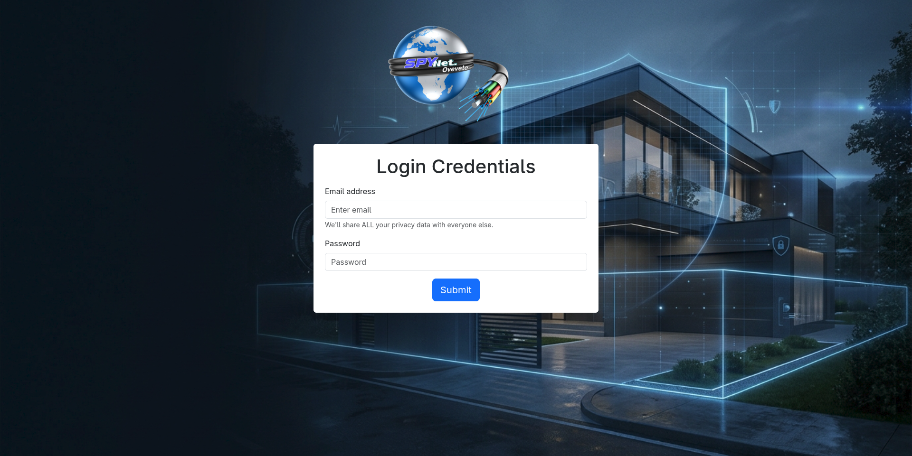
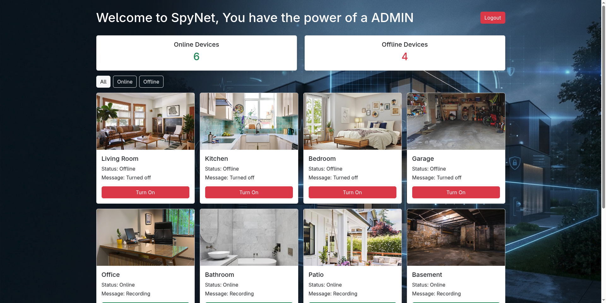
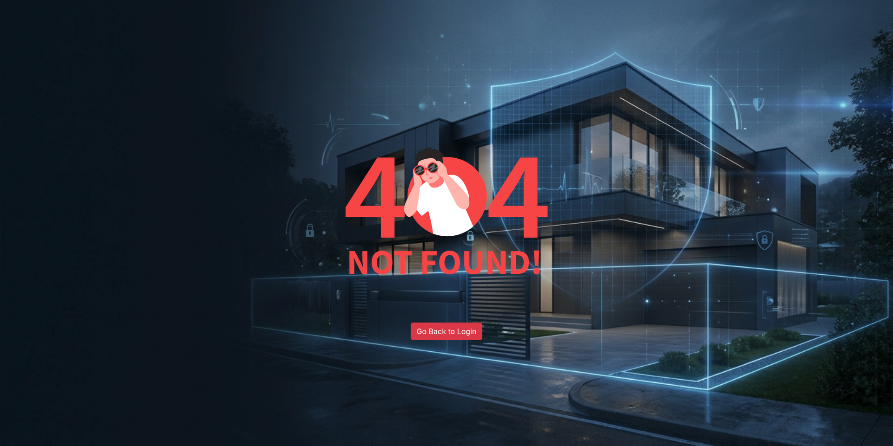

# SpyNet: Your home security dashboard
## Sigmaschool Mission 6 Submission

The mission request for us to build a home security dashboard using React + Javascript. Focus on the mission is on **building protected page**, **navigating with React Router**, **using React Context for authentication**, and **conditionally rendering the UI based on application state**.

## Overview of Spynet
1. **Login Page**

- Admin email address and password are:
```bash
Email Address: john@mail.com
Password: admin
```
- Guest email address and password are:
```bash
Email Address: guest@mail.com
Password: guest
```
2. **Dashboard Page**

- The **turn on and turn off** button can only be done by the **ADMIN**. Guest cannot turn on or turn off the devices

3. **Error Page**

- In the occurence that the user enters url with anything other than **../dashboard**, this error page will be displayed redirecting the user back to the login page

## Features
1. **Protected Routes**
- As the **Dashboard.jsx** is protected by the **RequireAuth.jsx** component, this makes it so that in the situation that someone would just like to **skip logging in** through means of adding **/dashboard** at the end of the html, they will not be able to due to the **missing token**

```bash
<AuthContext.Provider value={{ token, setToken }}>
      <BrowserRouter>
        <Routes>
          <Route index element={<Login />} />
          <Route element={<RequireAuth><Dashboard /></RequireAuth>} path="/dashboard" />
          <Route path="*" element={<ErrorPage />} />
        </Routes>
      </BrowserRouter>
</AuthContext.Provider>
```
```
export default function RequireAuth({ children }) {
  const token = useContext(AuthContext).token;

  if (!token) {
    return <Navigate to="/" replace />;
  }
  return children;
}
```
2. **Turn On / Turn Off Button for Devices**
- Login Credentials with Role **ADMIN** are able to turn on or off the devices

```
  const handleDeviceToggle = (deviceId) => {
    // Implementation for toggling device status

    if (!isAdmin) {
      alert("You do not have permission to perform this action.");
      return;
    }

    const updatedDevices = deviceList.map((device) => {
      if (device.id === deviceId) {
        if (device.status === "Online") {
          return { ...device, status: "Offline", message: "Turned off" };
        } else {
          return { ...device, status: "Online", message: "Recording" };
        }
      }
      return device;
    });
    setDeviceList(updatedDevices);
  };
```
3. **Filter by Online / Offline Devices**
- Every user regardless of their roles are able to filter between the Online and Offline devices and the webpage will react dynamically to it
```
  const [filter, setFilter] = useState("All");
  const filteredDevices = filter === "All" ? deviceList : deviceList.filter((d) => d.status === filter)
```
```
      <div className="d-flex gap-2 mb-3">
        {["All", "Online", "Offline"].map((option) => (
          <Button
            key={option}
            variant={filter === option ? "light" : "outline-light"}
            onClick={() => setFilter(option)}
          >
            {option}
          </Button>
        ))}
      </div>
```
```
        {filteredDevices.map((device) => (
          <Card key={device.id} className="af-grid-item">
            <Card.Img
              variant="top"
              src={device.image}
              alt={device.location}
              style={{height: "180px", objectFit: "cover"}}
            />
            <CardBody className="d-flex flex-column">
              <Card.Title>{device.location}</Card.Title>
              <Card.Text className="mb-1">Status: {device.status}</Card.Text>
              <Card.Text>Message: {device.message}</Card.Text>
              <Button 
                variant={device.status === "Online" ? "success" : "danger"}
                onClick={() => handleDeviceToggle(device.id)}
                >
                  {device.status === "Online" ? "Turn Off" : "Turn On"}
              </Button>
            </CardBody>
          </Card>
        ))}
```
## Programming Language Used
1. JSX
2. Javascript
3. CSS
4. HTML
5. JSON

## Library and tools
1. React
2. Vite
3. Bootstrap
4. ESLint